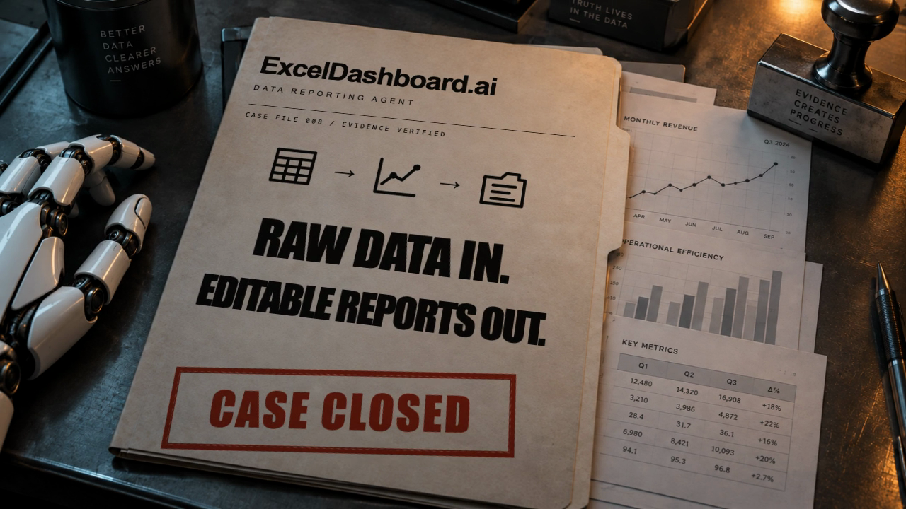

# ExcelDashboard.ai — Cinematic Remotion Trailer

An editable technology thriller about turning raw data into analysis, native editable charts and report presentations. Built for [ExcelDashboard.ai](https://www.exceldashboard.ai) by Quinn Yang Li and Alvin Zhe Xu.

[Customization guide](docs/CUSTOMIZE.md) · [Download demo and source](https://github.com/YangLi-AlgForce/remotion-data-agent-trailer/releases/latest)



**Public edition:** 45.9 seconds · 1280 × 720 · 30 fps. All visual scenes are editable. Includes an original synthesized suspense score and effects, **without narration**. Third-party production audio is excluded; add your own complete mix in `src/config.ts`. No API keys needed.

## What is inside

- Searchlight opening over spreadsheet evidence.
- Dark dashboard, line chart, executive summary and report/PPT scenes.
- Editable-chart demonstration and spoken-word camera tracking layout.
- CASE CLOSED stamp, rolling credit icons and CRT shutdown.
- ExcelDashboard.ai example branding, founder credits, and detailed replacement tutorials.

This repository is the video template. The displayed reporting interface and charts are illustrative animation; it does not contain the ExcelDashboard.ai product backend or a working data-analysis agent.

## Quick start

Install Node.js 22 or newer, then:

```sh
git clone https://github.com/YangLi-AlgForce/remotion-data-agent-trailer.git
cd remotion-data-agent-trailer
npm ci
npm run studio
```

Select `ExcelDashboardCase` in Remotion Studio. Export:

```sh
npm run render
```

Output: `out/demo.mp4`. The first render may download Remotion's browser. Python is optional: the ready-to-use demo soundtrack is included.

## Make it yours

Start with the [step-by-step guide](docs/CUSTOMIZE.md). Keep the default duration and resolution for the first edit.

| Change | Edit |
| --- | --- |
| Brand, product copy, chart data, summary, report | `src/ReportingScenes.tsx`, `src/Visual.tsx`, `src/scenes.json` |
| Opening captions and searchlight | `src/Opening.tsx` |
| Ending slogan, camera, stamp, founder names, portraits and icons | `src/Ending.tsx` |
| Complete soundtrack and volume | `src/config.ts` |
| Images | `public/` |
| Frame rate, dimensions, duration | `src/index.tsx` |

Place your complete 45.9-second soundtrack at `public/my-master.wav`; set `audioFile: 'my-master.wav'` in `src/config.ts`. Include narration, music and effects in that file. JSON narration records do not generate speech. Recreate the default soundtrack with `npm run audio:demo` (Python 3).

Content is still maintained in several components. There is no single configuration for all branding/data, automatic Excel ingestion, or responsive vertical layout. The guide identifies every manual replacement point and the timeline mapping.

## License

Original code, documentation, icons and synthesized audio: [MIT](LICENSE). Example portraits, branding, backgrounds and dependencies have separate scopes: [asset licenses](ASSET_LICENSES.md). Replace the founders' identities in your own branded videos. Remotion usage remains subject to [its license](https://www.remotion.dev/docs/license/faq).
